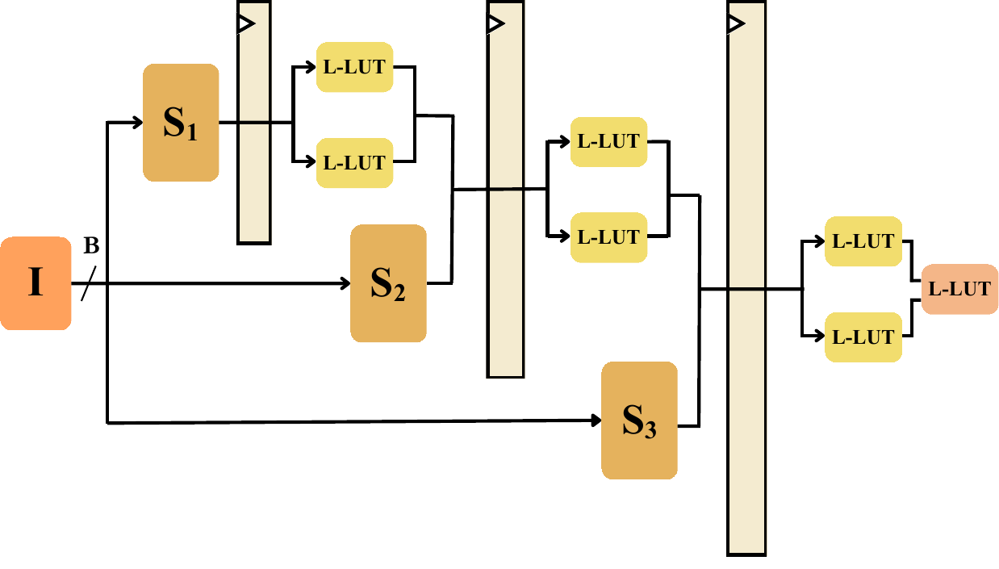

# CascadeLUT: Information-Ordered Streaming Inference for Bandwidth-Constrained FPGAs

[](https://ieeexplore.ieee.org/document/11754193)
[](https://arxiv.org/abs/2608.00720)
[](https://doi.org/10.23919/FPLCPS00026.2026.00028)

CascadeLUT is an information-structured inference framework for bandwidth-constrained FPGA deployments. Instead of buffering the full input before computation, features are partitioned into ordered subsets and predictions are progressively refined as subsets arrive. The cascade structure statically controls which layers consume incoming features, enabling deterministic streaming inference without runtime branching.

By co-designing feature scheduling and hardware dataflow, CascadeLUT reduces data movement while maintaining accuracy. It builds on the [NeuraLUT-Assemble](https://github.com/MartaAndronic/NeuraLUT) backbone, a derivative work based on [LogicNets](https://github.com/Xilinx/logicnets) (Apache License 2.0).

> This work is part of a publication at FPL 2026: O. Cassidy and M. Andronic and G. A. Constantinides, "CascadeLUT: Information-Ordered Streaming Inference for Bandwidth-Constrained FPGAs," 2026 36th International Conference on Field-Programmable Logic and Applications (FPL), pages 116-121, Ghent, Belgium, 2026.

<p align="left">
  
</p>

*Input features are partitioned into ordered subsets (S1, S2, S3) and injected into successive L-LUT pipeline stages. Each stage combines newly arriving features with propagated hidden activations, enabling computation to begin on the first load cycle.*

## Key Results (Zynq Z-7045, 200 MHz)

Across multiple datasets compared with prior LUT-based methods:

| Metric | Improvement |
|--------|-------------|
| Latency | Up to **12.5×** lower |
| Throughput | Up to **5.0×** higher |
| Energy per sample | Up to **13.8×** lower |

## Features

- **Statically scheduled cascade**: no runtime branching; feature schedule, cascade topology and pipeline are fixed at synthesis time, enabling deterministic latency aligned with input bandwidth.
- **Learned feature ordering**: transmits the most class-discriminative features first under a fixed bandwidth budget using weight-magnitude saliency scores.
- **Per-feature learned quantization**: low-bit threshold comparators fold batch normalization into a single L-LUT per feature, operating within the same load cycle as feature arrival.
- **On-device preprocessing**: integrated input quantization with modest area overhead - 5× reduction over NeuraLUT-Assemble on MNIST.
- **Latency scales with load stages**: computation begins on the first arriving subset, so end-to-end latency scales with load stages rather than total input size.

## Setup

**Clone the repository**
```
git clone https://github.com/ollycassidy13/CascadeLUT.git
cd CascadeLUT
```

**Install Vivado Design Suite**  
Download and install from [Xilinx Vivado](https://www.xilinx.com/products/design-tools/vivado.html).  
We used **Vivado 2020.1** in our experiments.

**Create a Conda environment**

Requirements:
* python=3.8.19
* pytorch==2.4.1
* torchvision==0.19.1
* brevitas==0.10.2
* cuda-version==12.4
* pyverilator==0.7.0

## Install CascadeLUT package
```
cd CascadeLUT
pip install .
```
## Install wandb + login
```
pip install wandb
wandb.login()
```
## Install oh-my-xilinx
```
git clone https://github.com/ollycassidy13/oh-my-xilinx.git /path/to/local/dir
export OHMYXILINX=/path/to/local/dir
```

## Install Verilator
```
sudo apt install verilator
```
We used **Verilator 4.108** in our experiments.

## Datasets

We provide examples to get started on one image dataset and one audio dataset:

- **MNIST** (image) - see [`datasets/mnist/`](datasets/mnist/)
- **ToyADMOS** (audio anomaly detection) - see [`datasets/toyadmos/`](datasets/toyadmos/) 

### Dataset Links

- **MNIST** / **FashionMNIST** - loaded automatically via `torchvision.datasets`
- **KWS** (Google Speech Commands) / **ToyADMOS** ([train](https://github.com/ollycassidy13/CascadeLUT/releases/download/v1.0.0/toyadmos-train.zip) /    [test](https://github.com/ollycassidy13/CascadeLUT/releases/download/v1.0.0/toyadmos-test.zip)) - benchmark splits sourced from [ULEEN](https://github.com/ZSusskind/ULEEN); please contact the ULEEN authors for access

## Summary of major modifications from NeuraLUT

* Introduces a cascade input architecture: input features are loaded serially in subsets, with each subset injected into a different hidden layer, reducing first-output latency.
* Adds a Layer-Q pre-quantisation frontend: per-feature 8-bit→1-bit LUTs fold normalisation and batch norm into a single truth table, allowing raw uint8 inputs at the hardware port.
* Supports configurable hardware bandwidth (`hw_bandwidth`) to handle narrow I/O ports with multi-cycle subset loading (LOAD_CPC > 1) without extra drain cycles (live-last-word protocol).
* Extends truth table generation to handle composite input quantisers (`CascadeCompositeInputQuant`) with mixed hidden/subset feature bitwidths.
* Adds `generate_cascade_top_module` for Verilog top-level generation with pipeline registers at cascade injection points.
* Introduces `LearnablePerFeatureMultiBitActivation` for k-bit per-feature learned quantisation with strict threshold ordering via cumulative-softplus.
* Adds `ThresholdTemperatureScheduler` for cosine-annealed temperature control across all learnable threshold modules.

>NOTE: The training flow in this repository improves over the original paper. We set $S_i$ to be 1 for all $i$, we use a sigmoid in place of the clipped linear surrogate and we use a cosine annealing schedule for the temperature of the threshold modules. These changes improve the training stability, and hopefully the reusability of the paper.

## Citation

If CascadeLUT contributes to your research, please cite:

```bibtex
@inproceedings{cassidy2026cascadelut,
  author={Cassidy, Oliver and Andronic, Marta and Constantinides, George A.},
  booktitle={2026 36th International Conference on Field-Programmable Logic and Applications (FPL)}, 
  title={CascadeLUT: Information-Ordered Streaming Inference for Bandwidth-Constrained FPGAs}, 
  year={2026},
  pages={116-121},
  doi={10.23919/FPLCPS00026.2026.00028}
}
```

CascadeLUT builds on NeuraLUT-Assemble; please also cite:

```bibtex
@inproceedings{andronic2025neuralut-assemble,
    author    = "Andronic, Marta and Constantinides, George A.",
    title     = "{NeuraLUT-Assemble: Hardware-Aware Assembling of Sub-Neural Networks for Efficient LUT Inference}",
    booktitle = "{2025 IEEE 33rd Annual International Symposium on Field-Programmable Custom Computing Machines (FCCM)}",
    pages     = "208-216",
    publisher = "IEEE",
    year      = 2025,
    note      = "doi: 10.1109/FCCM62733.2025.00077"
}
```
